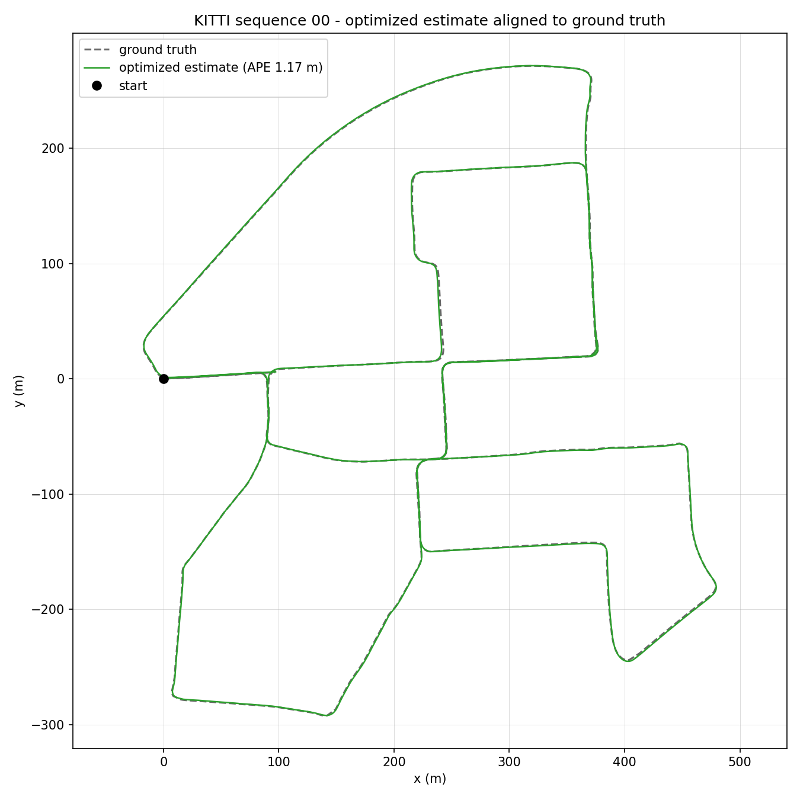
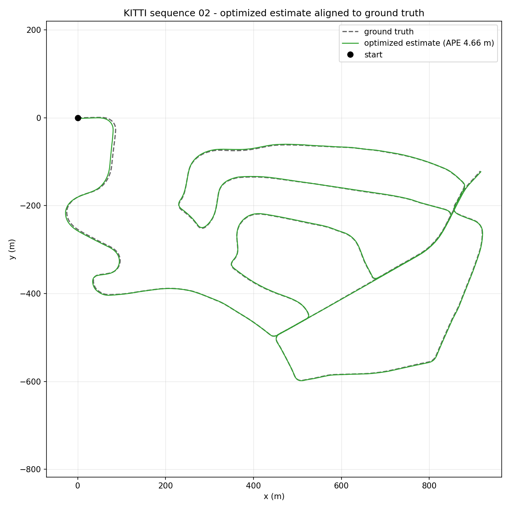
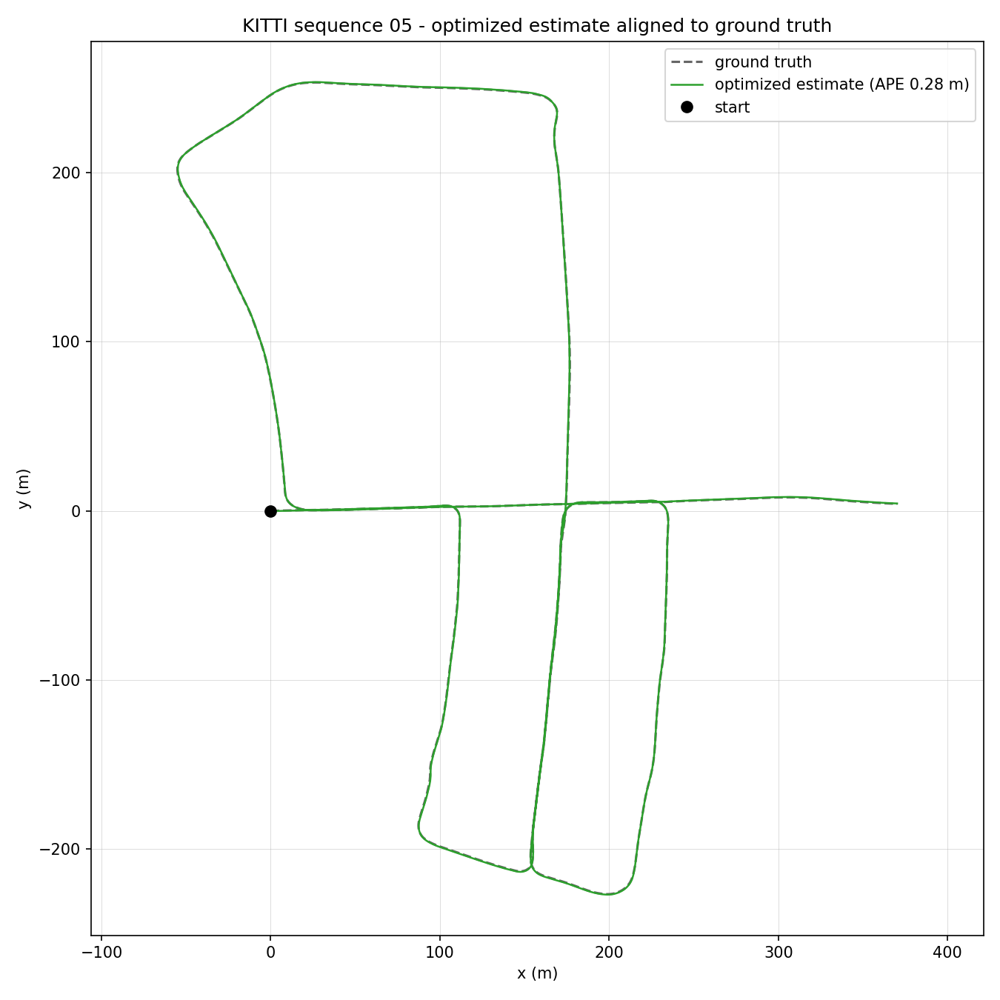
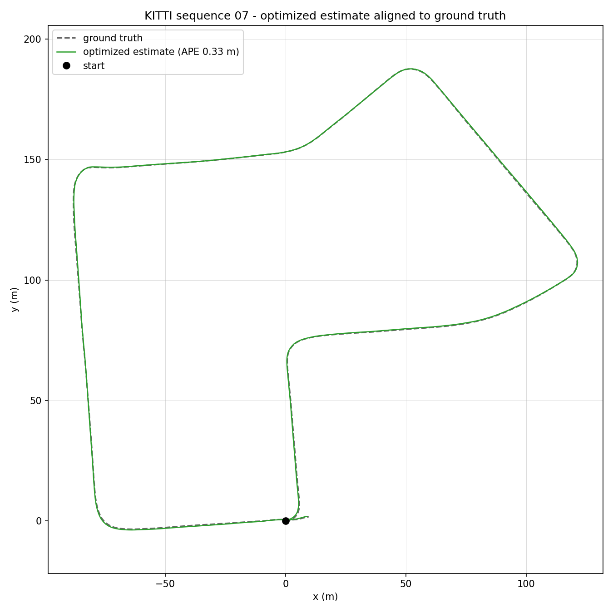
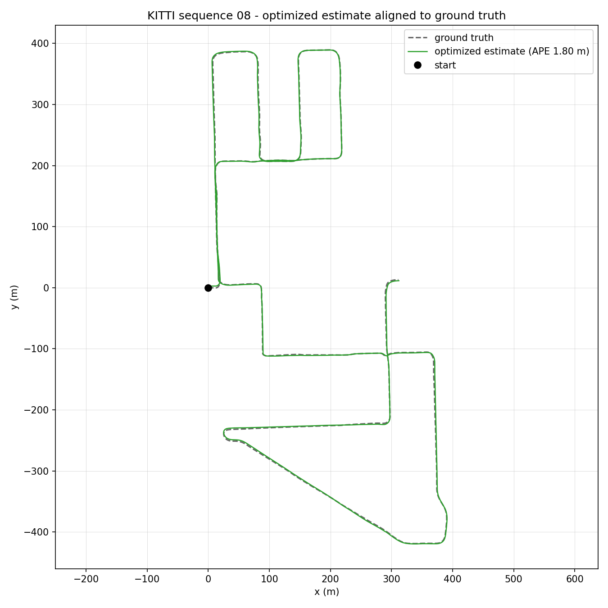
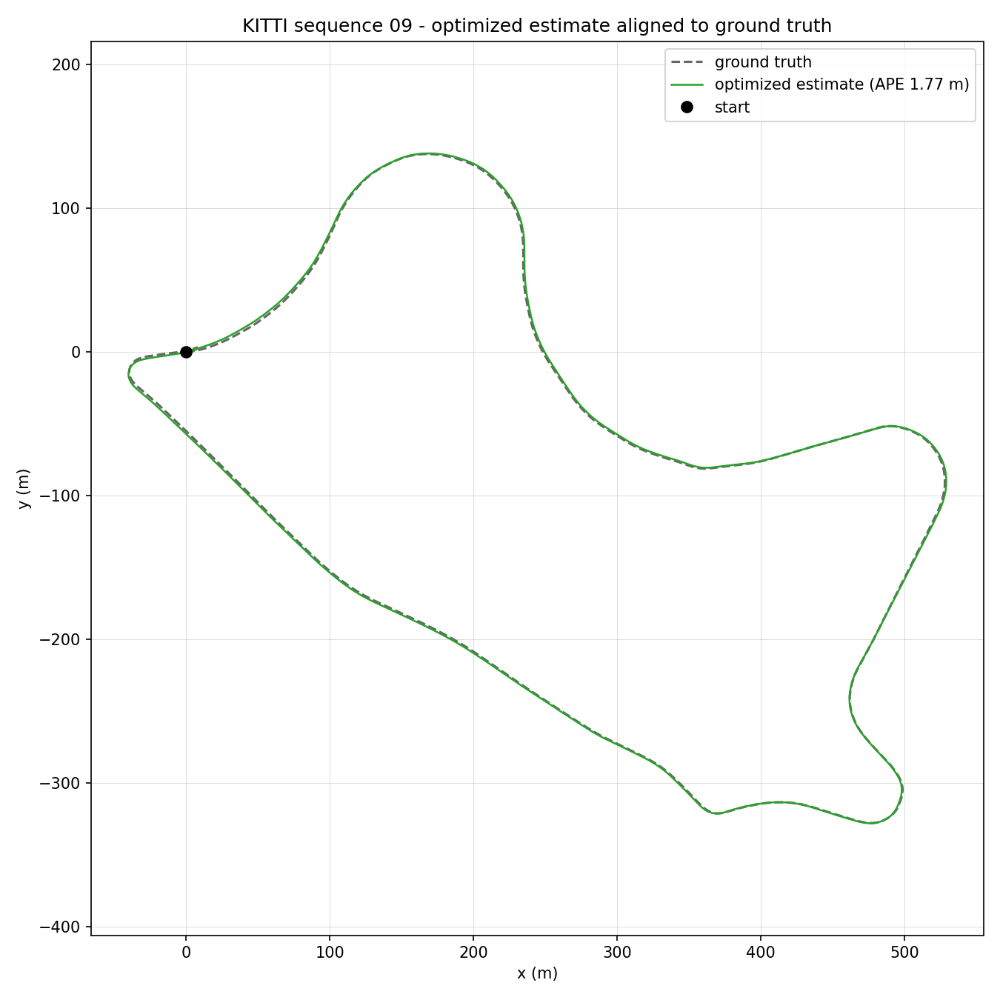

# Mapper3D

`Mapper3D` is a real-time 3D LiDAR pose-graph SLAM system for ROS 2. It combines a front-end LiDAR odometry and local mapping thread, that ensures real-time sensor processing and pose updates, with a backend submap-based loop closure detection and outlier-robust pose-graph optimization thread, that constructs globally consistent 3D maps.

The SLAM core is written as plain C++ libraries, fully decoupled from ROS 2, with a thin ROS 2 node that wraps it to handle message conversion and publishing. As such, the same core can be embedded in other applications or run offline on recorded data without ROS 2.

## Requirements

- ROS 2 (ament_cmake), C++17, CMake ≥ 3.22.
- Eigen3, Sophus, TBB, PCL, OpenCV, GTSAM, OpenVDB, blosc, `small_gicp` (registration), and `kiss_matcher`
  (global registration for loop closure, with `teaserpp` and `robin`).

These libraries must already be installed in the system or the workspace. If the build fails because a package
is missing, this is almost always the cause.

`3rdparty/small_gicp` is a git submodule. Clone with `--recurse-submodules`, or run
`git submodule update --init --recursive`. `3rdparty/Scancontext` is vendored ScanContext++ code.

## Build

This package is part of a colcon workspace, and is built from the workspace root:

```bash
cd <path_to_ros2_ws>
colcon build --packages-select mapper3d --symlink-install
source install/setup.bash
```

## Run

```bash
ros2 launch mapper3d mapper3d_launch.py
```

Then supply LiDAR point clouds, either from live hardware or from a recorded ROS 2 bag

To see the map and the trajectory, start RViz with the supplied configuration:

```bash
rviz2 -d src/mapper3d/rviz/mapper3d_config.rviz
```

## Architecture

<pre>
/velodyne_points
        │
┌───────▼───────────────┐              ┌───────────────────────────┐
│ <b>Front-end thread</b>      │              │ <b>Back-end thread</b>           │
│ Mapper3D              │              │ LoopClosureDetector       │
│   Filter              │   map→odom   │   Loop closure detection  │
│   LiDAR odometry      │◄─ ─ ─ ─ ─ ─ ─┤ GraphOptimizer            │
│   Keyframe selection  ├─────────────►│   Pose-graph optimization │
│ Mapper3DNode          │  keyframes   │   Map generation          │
│   Broadcasts /tf      │              └───┬───────────────────────┘
│   Wakes visualization │                  ╎ poses, loop closures, map
└───────────────────────┘                  ╎
                                       ┌───▼────────────────────────────────────────────────┐
                                       │ <b>Visualization thread</b>                               │
                                       │ Mapper3DNode                                       │
                                       │   Publishes /map, /pose_trajectory, /loop_closures │
                                       └────────────────────────────────────────────────────┘
</pre>

Solid arrows hand data over; dashed arrows are reads of another thread's data under its lock.

- **`Mapper3D`** is the front-end running on the main thread. It filters each incoming point cloud, registers them against a rolling local map of recent point clouds to estimate LiDAR odometry, and passes point clouds to the back-end as keyframes whenever the sensor has moved enough since the last point cloud. After each point cloud, `Mapper3DNode` broadcasts two transforms on `/tf`, stamped with the point cloud's time: `map`→`odom` (the back-end's drift correction) and `odom`→`velodyne` (the LiDAR odometry pose).
- **`GraphOptimizer`** is the back-end, running on its own thread. It builds a GTSAM pose-graph from the keyframes' odometry and loop closures, optimizes it with outlier-robust GNC, and rebuilds the OpenVDB map at the corrected poses.
- **`LoopClosureDetector`** finds the loop closures for the back-end. It groups keyframes into submaps, proposes revisited places with ScanContext++, and verifies each one with KISS-Matcher and GICP registration.

## KITTI datasets

`kitti_to_ros2_bag` converts a KITTI odometry sequence into a ROS 2 bag that can be played into the node:

```bash
ros2 run mapper3d kitti_to_ros2_bag <velodyne_dir> <timestamp_file> [output_bag_name]
```

## Evaluation

Every run writes four TUM-format trajectories (`lidar_odometry_tum.txt`, `online_estimate_tum.txt`,
`unoptimized_keyframes_tum.txt`, `optimized_keyframes_tum.txt`) plus `keyframe_stamps.txt` into the node's
working directory, for offline scoring with [`evo`](https://github.com/MichaelGrupp/evo).

For KITTI sequences, `kitti_gt_to_tum.py` converts a ground-truth file into the same TUM format so it can be
compared directly:

```bash
ros2 run mapper3d kitti_gt_to_tum.py --gt <poses>/xx.txt --sequence-dir <kitti_sequences_dir>/xx -o gt_07_tum.txt
evo_ape tum gt_07_tum.txt optimized_keyframes_tum.txt --align
```

## Results on KITTI

The following table and plots show the absolute trajectory error of the optimized keyframe poses (`optimized_keyframes_tum.txt`) against KITTI odometry ground-truth, measured at commit `3aaa692` with `regression_test.py`. The score is the RMSE from `evo_ape tum gt.txt optimized_keyframes_tum.txt --align`. Ground-truth is converted into the LiDAR frame first (`kitti_gt_to_tum.py`).

| Sequence | Length (km) | Point Clouds | Keyframes | Loop closures | Optimized APE (m) |
| --- | ---: | ---: | ---: | ---: | ---: |
| 00 | 3.72 | 4541 | 2721 | 358 | **1.174** |
| 02 | 5.07 | 4661 | 3899 | 212 | **4.665** |
| 05 | 2.21 | 2761 | 1671 | 190 | **0.276** |
| 07 | 0.69 | 1101 | 505 | 2 | **0.333** |
| 08 | 3.22 | 4071 | 2354 | 31 | **1.803** |
| 09 | 1.70 | 1591 | 1252 | 4 | **1.772** |

Each plot shows the optimized trajectory estimate against the ground-truth trajectory in the xy plane:

<table>
  <tr>
    <td></td>
    <td></td>
  </tr>
  <tr>
    <td></td>
    <td></td>
  </tr>
  <tr>
    <td></td>
    <td></td>
  </tr>
</table>

## Regression testing

`regression_test.py` runs the KITTI sequences and checks that a change has not made the pipieline's estimated trajectories less accurate. It also records the pipeline's peak memory and CPU usage, how many loop closures it found, and writes a `trajectories.png` per sequence showing trajectory estimates against ground-truth. The results are compared against `test/regression_baseline.json`.

```bash
ros2 run mapper3d regression_test.py                  # all sequences, compare to the baseline
ros2 run mapper3d regression_test.py --sequences xx   # one sequence
```

Exit code 0 means every sequence passed, 1 means a regression or a failed run, and 2 means data was missing for a sequence. The baseline is stamped with the commit it came from. To refresh it, check out `master`, rebuild, and run:

```bash
ros2 run mapper3d regression_test.py --update-baseline
```